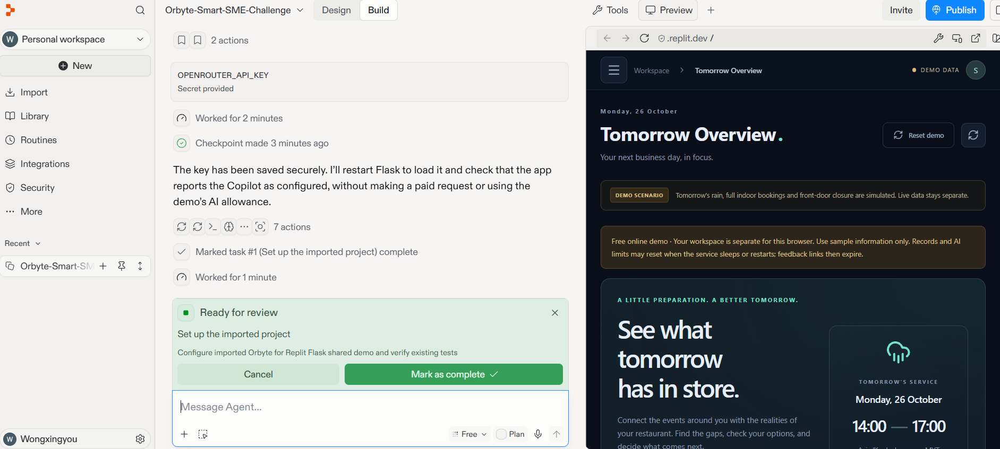

# Orbyte · Ready for Tomorrow

A restaurant readiness MVP for SMEs: **events → business conditions → plan checks → voluntary confirmation → owner approval → execution tracking**.

English interface, dark responsive UI, and MYR amounts displayed consistently as **RM 1,250.00**. React 18 / Vite 5 frontend, Flask backend, SQLite persistence. OpenRouter powers the real AI Copilot; deterministic Python rules decide condition status.

## Replit utilization

**Replit project:** [Open Orbyte on Replit](https://replit.com/@wongxingyou2005/Orbyte-Smart-SME-Challenge).

Team Allstar imported Orbyte's existing GitHub codebase into Replit and used **Replit Agent** to configure the application's Flask demo environment. The application was then run in **Replit Preview** to review its interface and functionality.

The screenshot below documents the Replit project name, Agent setup conversation and checkpoint, and Orbyte's running preview. It also shows that the OpenRouter key was supplied through Replit's secret input, without displaying the key value.



[Open the full Replit evidence screenshot](docs/evidence/replit-workspace.png).

The original codebase existed before this import. Replit's documented role was importing, configuring and running the existing application. The screenshot is evidence of that setup and preview; it does not by itself establish that automated tests or a real AI request succeeded inside Replit. OpenRouter powers the in-app Copilot, while the separate public demo is hosted on [Render](https://orbyte-readiness-demo.onrender.com).

## Start locally (Windows / PowerShell)

Requires Node.js 18+ (20+ recommended), Python 3.11+ and Internet access for initial dependency installation. Do not reuse the checked-in/old `back_end/venv`: it refers to another machine. Create a fresh ignored `.venv`.

Backend, from the project root:

```powershell
cd back_end
py -3 -m venv .venv
.\.venv\Scripts\python.exe -m pip install -r requirements.txt
Copy-Item .env.example .env
# Edit .env locally; enter your OpenRouter key there.
.\.venv\Scripts\python.exe app.py
```

If `py` is unavailable, use your installed `python` executable for the venv command. Activation is optional; using the explicit venv Python avoids PowerShell activation-policy issues.

Frontend, in a second terminal:

```powershell
cd front_end
npm install
npm run dev
```

Open **http://127.0.0.1:5173**. Vite proxies `/api` to Flask at port 5000. If dependencies are already installed and `npm` is not on PATH, start Vite with `node node_modules/vite/bin/vite.js`.

## OpenRouter AI Copilot

Set these **backend-only** variables in `back_end/.env`, then restart Flask:

```dotenv
OPENROUTER_API_KEY=your_local_key
OPENROUTER_MODEL=openrouter/free
```

Never put the key in a frontend `VITE_*` variable. `.env` and the SQLite database are ignored by Git. No key is bundled. The app explicitly reports missing configuration, provider errors, timeout, rate limiting and tool-loop limits; it does not fabricate an AI response.

The default free router selects a tool-capable model from its available pool. Availability and latency vary. Set `OPENROUTER_MODEL` to a specific supported model ID if desired; the app never automatically switches to a paid model.

The Copilot:
- Reloads the saved store, target service, events, checks, observations, verifications and actions each turn.
- Uses allowlisted tools to read context, check hypothetical conditions, inspect confirmations/tasks and create drafts.
- Persists successful conversations; ignores client-supplied message history.
- Returns verified record links and draft cards. A valid link verifies that a record exists, not that every model-generated statement is correct.
- Cannot approve/execute actions, verify tomorrow's access or complete tasks. Those endpoints are not exposed as model tools.
- Treats merchant notes, customer observations and external notices as untrusted data. Only rules establish the three check states.
- Sends the relevant business context to OpenRouter when you submit a chat message. Test with demo information first.

Example prompts:
- What could affect tomorrow afternoon?
- Indoor seating is full. Can we switch to delivery?
- What do we still need to confirm?
- Draft a customer notice for rear-door pickup.
- Which preparation tasks are still pending?

Reference: [OpenRouter tools](https://openrouter.ai/docs/guides/features/tool-calling), [free router](https://openrouter.ai/docs/guides/routing/routers/free-router).

## Present the full demo

The initial UI opens the **Demo scenario**, an isolated SQLite workspace. Its rain and front-road closure are **simulated**, with indoor capacity fully booked.

1. Review **Tomorrow Overview** or **Plan Checks**: indoor conflict → front-door conflict → rear-door information missing.
2. Create a rear-access question in **Confirmations** and open its feedback link.
3. On the customer page, voluntarily answer **No — no blockage seen** and submit an observation time in Malaysia time.
4. Refresh Confirmations (or wait for its 10-second refresh). The rear plan must still say **More information needed**.
5. Independently verify tomorrow's service window in the owner form. Select **Confirmed usable** and record how you checked the future works schedule.
6. Review the updated rear plan. Choose **Prepare action draft**, enter instructions, responsible person, recipient and estimated RM cost.
7. **Approve this action**, then **Start preparation task**, then record a completion note.
8. For a customer notice or supplier inquiry, choose a verified operational plan, approve, then **Simulate sending this message**. It waits for an owner-recorded reply before completion. No real email, SMS or WhatsApp is sent.

The business date is calculated in **Asia/Kuala_Lumpur**. After midnight, old questions/actions are not silently moved to tomorrow. Update the live service window or reset the demo.

Reset only demo data with **Reset demo**, or:

```powershell
cd back_end
.\.venv\Scripts\python.exe -m flask --app app reset-demo
```

Live store data is preserved. Demo conversations are cleared by a reset.

## Live workspace and evidence

Switch to **Live workspace**, confirm **Business Profile**, then **Events & Evidence → Refresh forecast**. Initial live profile values are sample settings, not verified merchant information.

- Forecasts use the saved coordinates and tomorrow's hourly Open-Meteo forecast in Malaysia time. Rain is flagged when probability is at least 60% or precipitation is above zero.
- Weather is considered stale after six hours, on a target-date/location mismatch, or after a refresh failure. Cached hours remain visible and labeled out of date, but cannot establish current conditions.
- Local closures, construction, utility interruptions and activities can be entered with source name/link, affected entrance/facility and start/end times. Merchant-entered notices are not represented as automatically verified official notices.
- Only events overlapping the selected service window affect checks. Activities are contextual evidence; the MVP does not infer crowd size or revenue.
- Indoor checks use the peak booked-seat count for the entered reservation window. Pickup checks cover entrance access, staffing, delivery hours, water and electricity.
- An explicit unavailable condition takes priority over missing information. **Known conditions met** never guarantees operational success.
- What-if changes do not update store conditions, approvals or verifications.
- Customer responses are unverified observations, with separate observation/submission times. Conflicting, skipped and uncertain responses never automatically resolve the condition. Owner verification requires notes and an exact target window.
- Unexecuted approvals are invalidated when business conditions, events, weather or owner verifications change. Execution also rechecks current conditions and date. Internal preparation/investigation tasks may be approved before operational unknowns are resolved.

Forecast source: [Open-Meteo](https://open-meteo.com/en/docs). Provider attribution is also visible in the app.

## Customer page on another device

For a trusted local-network demonstration, start the frontend with:

```powershell
npm run dev -- --host 0.0.0.0
```

Open the displayed network URL (your computer's LAN address) on the owner's browser before copying the customer link. The feedback link then uses the same LAN origin and works on a phone on that network. Keep Flask on 127.0.0.1; Vite forwards the requests. Windows may require a local firewall permission.

The local installation has **no owner login** and assumes one trusted owner. The hosted demo uses separate anonymous browser sessions for sample data; it is not a production merchant account system. Customer token endpoints return only the question, store name and target window, without exposing private store settings or observations.

## Deploy the free online demo on Render

The root `Dockerfile` builds React, then serves the frontend and Flask API together with Gunicorn. `render.yaml` configures one **Free** Docker web service in Singapore. No database subscription or persistent disk is required.

1. Push the source to your own GitHub repository. Keep `.env`, virtual environments, databases and `node_modules` excluded; `.gitignore` and `.dockerignore` already do this.
2. In Render, choose **New → Blueprint**, connect that repository and select `main`. Review the single Free web service before creating it. Alternatively choose **New → Web Service**, Docker, repository root, Free, Singapore, and health check `/api/health`.
3. Enter `OPENROUTER_API_KEY` as a secret environment variable in Render. Never paste it into GitHub source, a build argument, a frontend variable or a chat. Friends use the website without providing their own key.
4. Keep `OPENROUTER_MODEL=openrouter/free`. The Blueprint generates `ORBYTE_SESSION_SECRET`; for manual setup, generate a long random secret and set it in Render. Do not reuse the OpenRouter key as the session secret.
5. The Blueprint sets `ORBYTE_HOSTED_DEMO=1`, `ORBYTE_AI_PER_IP_DAILY_LIMIT=3`, and `ORBYTE_AI_DAILY_LIMIT=12`. For manual setup, add these variables too. Wait for the build to finish, then open the generated HTTPS `onrender.com` URL.
6. Check `/api/health`, run the demonstration above and send one Copilot message. Share the HTTPS website URL with friends. Do not share the Render dashboard, secret values or a local `127.0.0.1` address.

Hosted behavior:

- Anyone with the website link can explore the simulated scenario. Each browser receives a signed, HttpOnly, Secure session cookie and separate workspace/conversations. Clearing the cookie starts another sample workspace. It does not bypass the network-wide AI limit.
- The online service exposes only Demo mode. Live weather and real merchant records remain available in the local installation. Use sample information online; no owner login is provided.
- Shared AI requests use the owner's backend key. Every validated attempt counts, including a provider timeout or limit error; a missing key does not count. Defaults allow 3 attempts per network and 12 globally per Malaysia calendar day. A chat may make up to 5 provider requests and 8 tool calls. Copilot never switches automatically to a paid model.
- The database stores a salted hash of the network address for the allowance, not the raw IP. People on the same Wi-Fi share the network allowance. One Copilot turn runs at a time; a concurrent request receives a retry message.
- **Reset demo** clears only that browser's sample workspace and conversations. It does not clear the shared AI allowance or another visitor's workspace. Public feedback tokens route to their originating workspace, even from a different browser.
- Render Free sleeps after 15 idle minutes and can take about a minute to wake. Its filesystem is temporary: sleep, restart or redeploy can erase records, conversations, feedback links **and quota counters**. These limits are best-effort demo controls, not a durable billing cap. Set a separate provider-side key limit if a hard ceiling is needed.
- No payment method or paid upgrade is needed for this configuration. Render may suspend the free service if its included allowance is exhausted. See [Render's free-service limitations](https://render.com/docs/free).

For production use, add owner authentication and durable storage for records and usage counters before entering real merchant data. This free demo intentionally accepts resets.

## API and persistence

SQLite database: `back_end/orbyte.sqlite3` (override with `ORBYTE_DATABASE`). It initializes automatically. Each workflow mutation and its audit entry are saved in one SQLite transaction. `X-Workspace: live|demo` selects the owner workspace; the public feedback token resolves its own workspace.

Main endpoints:
- `GET /api/state` — latest store, checks, records and configuration availability.
- `GET /api/health` — deployment health check without private data.
- `PUT /api/business` — save profile and target window.
- `POST /api/events`, `DELETE /api/events/:id`, `POST /api/weather/refresh`.
- `GET /api/checks`, `POST /api/checks` — saved checks or unsaved assumptions.
- `POST /api/questions`, `POST /api/questions/:id/verify`.
- `GET /api/public/questions/:token`, `POST /api/public/questions/:token/responses`.
- `POST /api/actions`, `PUT /api/actions/:id`, `POST /api/actions/:id/approve|execute|complete`.
- `GET /api/copilot/conversations`, `POST /api/copilot/chat`.
- `POST /api/demo/reset` — demo only.
- `/api/greeting` retained. `/api/simulations` is now the same side-effect-free what-if check as `POST /api/checks`; old weather/incident percentage inputs are no longer supported.

Check states: `conditions_met`, `conflict`, `insufficient_data`.
Action states: `draft` → `approved` → `in_progress` (task) / `waiting_reply` (simulated notification) → `completed`. Changed conditions move unexecuted approved actions to `needs_review`. Approval snapshots/history, execution time and completion notes are retained.

One service window per day is supported, with opening, booking and delivery windows within that day. No overnight windows, real notifications, multi-store management or generic industry rule builder are included.

## Verification

```powershell
cd back_end
.\.venv\Scripts\python.exe -m unittest -v test_app
```

```powershell
cd front_end
npm test
npm run build
```

Without npm on PATH, use `node --test src/lib.test.js` and `node node_modules/vite/bin/vite.js build`.

Tests exercise the complete workflow, SQLite restart persistence, approvals and repeated execution, changed conditions, conflicting observations, time overlap, Malaysian midnight, forecast failures, input validation, Copilot tool boundaries, hypothetical checks, verified references, missing credentials, provider failures and bounded tool loops. Model tests use mocked provider responses, without needing or spending an API key.
